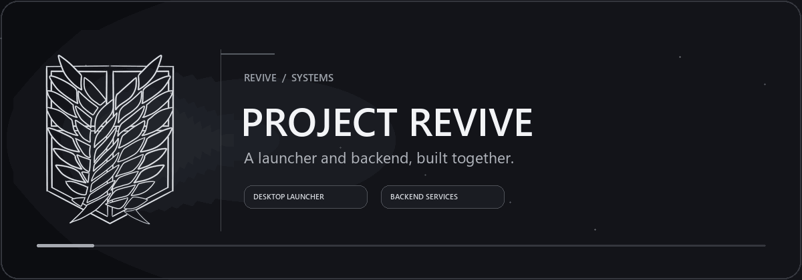

<div align="center">



# Revive Backend

**The services behind the Project Revive launcher.**

[](https://nodejs.org/)
[](https://expressjs.com/)
[](https://www.mongodb.com/)

</div>

## Overview

Revive Backend is a Node.js service for the Project Revive community. It provides account and game services, matchmaking and XMPP features, an optional website, and a Discord bot.

## Highlights

- Account, profile, locker, friends, and party services.
- Item shop, gifting, and V-Bucks management.
- Matchmaking and multi-game-server configuration.
- Optional Discord bot for account and moderation commands.
- Optional website, HTTPS, and Caldera service.
- Configurable seasonal content and game events.

## Get started

### Requirements

- Node.js 18 or newer
- MongoDB Community Server
- A Discord application and bot token if you enable the Discord bot

### Install and configure

```powershell
git clone https://github.com/333sematary/revive-backend.git
cd revive-backend
npm install
Copy-Item Config/config.example.json Config/config.json
Copy-Item tokenManager/tokens.example.json tokenManager/tokens.json
```

Edit `Config/config.json` for your database, server addresses, and optional services. Keep bot tokens, database credentials, API keys, webhooks, and TLS private keys private. The real configuration and token cache are excluded from Git.

### Start the backend

```powershell
node index.js
```

On Windows, `start.bat` can also be used to keep the process running after a restart.

## Discord bot

The bot is disabled in the example configuration. To use it, add your bot token and server settings to `Config/config.json`, then enable `discord.bUseDiscordBot`. Configure moderator IDs before giving the bot access to a community server.

The bot includes user account commands and moderator tools for account management, cosmetics, V-Bucks, and custom matchmaking codes.

## Configuration and data

- `Config/config.example.json` is a safe starting template. Copy it to `Config/config.json` and adjust it for your server.
- `tokenManager/tokens.json` is generated runtime state and should not be shared.
- `ClientSettings/` contains local player data and is ignored by Git.
- To serve static images from the API, place them in `Website/Data/Images/`; they are available under `/Images/`.
- HTTPS is optional. If enabled, configure your own certificate paths and keep private keys out of the repository.

## Repository layout

```text
Api/                 Launcher and game API routes
DiscordBot/          Discord commands and bot startup
Website/             Optional website and static assets
routes/              Game service endpoints
structs/             Shared backend services
responses/           Game response data
Config/              Local configuration (example only is tracked)
```

## Credits and disclaimer

Thanks to the contributors listed in the project history, including Waslyl for arena code. Revive is an independent community project and is not affiliated with Epic Games. See `LICENSE` for the backend license.
